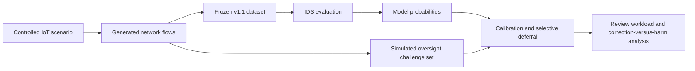

# HITL-IoT

[-1f6feb)](https://journal.benchcouncil.org/TBench)
[](CHANGELOG.md)
[](https://www.kaggle.com/datasets/abubakarwakili/hitl-iot-human-in-the-loop-iot-ids-dataset)
[](LICENSE)
[](CITATION.cff)
<!-- After the Zenodo v1.1 record is published, add:
[](https://doi.org/10.5281/zenodo.NNNNNNNN) -->

### A reproducible benchmark for trustworthy human–AI oversight and selective deferral in IoT cybersecurity

**Dataset:** v1.1 · **Research areas:** IoT intrusion detection, trustworthy AI, uncertainty, selective prediction and decision oversight · **Data type:** Deterministically generated flow-level records

HITL-IoT is an open research benchmark designed to study **both threat detection and what happens after an AI system makes a prediction**. It provides a controlled smart-home IoT environment, a fixed evaluation protocol and structured oversight variables for comparing intrusion detectors, confidence calibration, selective deferral and review-allocation strategies.

Unlike capture-based IoT datasets focused primarily on network-event classification, HITL-IoT makes it possible to investigate **when a decision should be accepted, reviewed, escalated or deferred** under consistent experimental conditions. It complements—not replaces—datasets collected from operational or experimental networks such as CICIoT2023 and ToN-IoT.

> **Data provenance.** All network flows in HITL-IoT v1.1 are **synthetically generated**. The 10,227-record oversight subset contains **simulated profile decisions**, including generated confidence, latency and evidence-based rationales. These are not observations from recruited cybersecurity analysts, real human annotations or measured expertise levels.

**Navigate:** [Overview](#dataset-at-a-glance) · [Design](#benchmark-design) · [Tasks](#research-tasks) · [Results](#reference-results) · [Access](#data-and-code-access) · [Quick start](#quick-start) · [Citation](#citation) · [Limitations](#scope-and-limitations)

---

## Dataset at a glance

| Property | HITL-IoT v1.1 |
|:--|--:|
| Network-flow records | **127,845** |
| Benign / attack records | **108,668 / 19,177** (85% / 15%) |
| Dataset columns | **60** |
| IoT device types / device instances | **5 / 12** |
| Attack families | **12**, across 4 threat groups |
| Simulated oversight subset | **10,227** records |
| Primary IDS feature set | **39** permitted source features |
| Context-enriched IDS feature set | **40** permitted source features |
| Chronological train / validation / test | **89,492 / 19,176 / 19,177** |
| Generation | **Seed 42**, seven-day controlled scenario |

**Device categories:** IP cameras, thermostats, smart speakers, smart TVs and video doorbells.

**Attack coverage:** reconnaissance (port scanning, network mapping, service enumeration); command and control (botnet communication, remote administration, device hijacking); data movement (DNS tunnelling, bulk data transfer, credential harvesting); and device manipulation (protocol abuse, firmware exploitation, configuration tampering).

## Why a benchmark for oversight?

Strong intrusion-detection accuracy does not guarantee that model confidence is reliable or that intervention improves outcomes. HITL-IoT separates the **prediction task** from the **oversight task** so that researchers can assess error prioritisation, review workload, deferral decisions and the possibility that an intervention may correct—or harm—an automated decision.

The benchmark makes four design choices explicit:

1. **Controlled generation:** a seeded, documented smart-home flow generator and configurable traffic overlap/ambiguity.
2. **Feature governance:** detection features are separated from labels, construction signals, identifiers and oversight metadata.
3. **Independent evaluation:** calibration and deferral use predictions from trained IDS models rather than the generator's scores.
4. **Traceability:** frozen files, predefined data splits, schema, configuration and SHA-256 integrity records support repeatable evaluation.

## Benchmark design



The **oversight challenge set** is selected using construction-time ambiguity. Its configurable profiles are benchmark parameters, **not** proxies for empirically validated human expertise. Researchers must avoid using these generated variables as primary IDS predictors.

## Research tasks

| Task | Evaluation focus | Suggested measures |
|:--|:--|:--|
| **T1 — Intrusion detection** | Binary benign/attack classification on the frozen split (scorer in [`benchmark/`](benchmark/)) | Macro-F1, balanced accuracy, MCC, AUROC, FPR/FNR |
| **T2 — Probability calibration** | Reliability of model-produced confidence | Brier score, expected calibration error, reliability diagrams |
| **T3 — Selective prediction** | Errors remaining after uncertain cases are deferred | Coverage, selective risk, risk–coverage curves |
| **T4 — Oversight and review allocation** | Which cases are reviewed and whether intervention helps | Review budget, errors reached, corrected vs harmed decisions |
| **T5 — Learning to defer** | Policies allocating cases between model and simulated reviewer | Matched-budget performance, workload and decision cost |
| **T6 — External validation** | Dataset shift with independently collected IoT datasets | Transfer performance, calibration and selective-review behaviour |

T1–T6 reflect the evaluation programme described in the accompanying manuscript. **Real-analyst validation and deployment studies remain future research**, not established properties of the released simulation.

## Reference results

The manuscript evaluates nine model families using a **chronological 70/15/15 train/validation/test protocol**. The validation-selected Random Forest is the reference IDS for subsequent calibration and deferral analyses.

| Model | Chronological test Macro-F1 |
|:--|--:|
| Logistic Regression | 0.9239 |
| SVM (RBF) | 0.9428 |
| **Random Forest** | **0.9688** |
| XGBoost | 0.9677 |
| LightGBM | 0.9682 |
| MLP | 0.9584 |
| 1D-CNN | 0.9624 |
| LSTM | 0.9629 |
| Soft-voting ensemble | 0.9684 |

For the Random Forest reference: **accuracy 0.9849, balanced accuracy 0.9491, MCC 0.9395 and AUROC 0.9690**. Any row can be re-scored from the released held-out probabilities with [`benchmark/score_track1_submission.py`](benchmark/); for example, scoring the Random Forest probabilities gives exactly the values above. Notebook 03 retrains all nine models from scratch.

The external CICIoT2023 and ToN-IoT experiments find substantial domain shift and restricted direct transfer; within-domain probability calibration and review prioritisation should not be mistaken for proven operational generalisation.

## Data and code access

| Resource | Purpose | Access |
|:--|:--|:--|
| **GitHub repository** | Source code, documentation, issue tracking and release assets | This repository; see [Releases](../../releases) |
| **Kaggle** | Existing public dataset page and notebook discovery | [HITL-IoT dataset on Kaggle](https://www.kaggle.com/datasets/abubakarwakili/hitl-iot-human-in-the-loop-iot-ids-dataset) |
| **Zenodo** | Archival version record and persistent data citation | A verified **v1.1 version-specific DOI will be added after deposit** |

**Release synchronization:** the existing GitHub and Kaggle pages may still show legacy v1.0 assets or metadata. The frozen **v1.1** files and their integrity records are prepared for publication; the versioned release should be treated as public **only after the matching archives and DOI are verified**. Earlier versions will remain available for provenance.

### Repository structure

| Path | Contents |
|:--|:--|
| [`data/v1.1/`](data/v1.1/) | Frozen v1.1 metadata: schema, feature policy, configuration, manifest, generation report, v1.0→v1.1 schema mapping, **generator** (`hitl_iot_generator_v1_1.py`) and SHA-256 checksums |
| `data/v1.1/*.csv` | Dataset, oversight subset and splits: **release assets**, fetched by `scripts/download_release_assets.py` |
| [`notebooks/`](notebooks/) | 01 quick start · 02 descriptive analysis · 03 nine-model IDS benchmark · 04 calibration, oversight and selective deferral · 05 external validation |
| [`benchmark/`](benchmark/) | Official Track-1 scorer, protocol, submission template, frozen requirements |
| [`results/`](results/) | Table 7 summary; four result archives are release assets |
| [`scripts/`](scripts/) | Download and integrity-verification scripts |
| [`docs/`](docs/) | Project website (GitHub Pages) |
| [`legacy/v1.0/`](legacy/v1.0/) | Superseded v1.0 files, kept for provenance only; **do not use for new results** |

Large research artifacts are distributed as release and deposit assets rather than committed to Git history. The trained-model package should be loaded only in a trusted, isolated environment (pickled models can execute code).

## Quick start

```bash
git clone https://github.com/abubakarwakili9/HITL-IoT--Human-in-the-Loop-Intrusion-Detection-Dataset.git hitl-iot
cd hitl-iot
pip install pandas scikit-learn
python scripts/download_release_assets.py    # fetches the three v1.1 CSVs into data/v1.1/ and verifies SHA-256
python scripts/verify_merged_release.py      # checks all 13 frozen files, counts and splits
```

Then load the data:

```python
import json
from pathlib import Path
import pandas as pd

root = Path("data/v1.1")
df = pd.read_csv(root / "HITL-IoT_dataset_v1.1.csv", low_memory=False)
policy = json.loads((root / "HITL-IoT_feature_policy_v1.1.json").read_text())

primary_features = policy["track1_primary_flow_only"]
assert len(df) == 127_845
assert len(primary_features) == 39
assert all(column in df.columns for column in primary_features)

print("Dataset:", df.shape)
print("Class counts:", df["is_attack"].value_counts().to_dict())
print("Primary IDS features:", len(primary_features))
```

For model training, apply the **provided split assignments**, fit preprocessing only on training records, use the **39 permitted primary features**, and reserve the test partition for final evaluation. Do not add `generated_attack_score`, `generated_prediction`, `ambiguity_score`, simulated oversight fields, labels or identifiers to the primary IDS feature matrix. The schema and policy files are authoritative for individual field roles.

## Citation

**Associated accepted manuscript:**

> Wakili, A., Idris, M., and Bakkali, S. *HITL-IoT: A Reproducible Dataset and Benchmark for Studying Trustworthy Human–AI Collaboration, Oversight Mechanisms, and Selective Deferral in IoT Cybersecurity.*

**Journal:** [*BenchCouncil Transactions on Benchmarks, Standards and Evaluations* (TBench)](https://journal.benchcouncil.org/TBench)  
**Publication status:** Accepted for publication; currently in copyediting. Final article DOI, volume, issue and page details are pending.

For reproducible research, please cite **both the article and the exact dataset version** when the final identifiers are available. A validated `CITATION.cff` and version-specific Zenodo DOI will be provided with the public release. Do not cite an unverified DOI for v1.1.

## Scope and limitations

- **Generated, not captured traffic.** The data represent a controlled smart-home scenario; no raw network PCAP or production telemetry is implied.
- **Simulated, not recruited reviewers.** Profile confidence, latency, decisions and rationales are constructed benchmark signals—not measurements of practitioners.
- **Temporal split is not drift validation.** Chronological evaluation does not by itself demonstrate robustness to deliberate concept drift.
- **Cross-domain transfer is limited.** Results on CICIoT2023 and ToN-IoT motivate independent external validation and realistic recalibration.
- **No certification claim.** This research supports studies of oversight mechanisms; it does not establish compliance with AI regulation or fitness for deployment.

## License, contributions and maintenance

The existing dataset release identifies **CC BY 4.0** for data. Source-code licensing and redistribution rights are being reviewed separately; no unverified MIT software license is claimed here. See the applicable license information with each published artifact.

**Corresponding author:** Abubakar Wakili. Issues reporting reproducibility problems, missing metadata, licensing questions or proposed benchmark extensions are welcome through [GitHub Issues](../../issues). Authorship and institutional details will be aligned with the final journal record.

**Version note:** the **dataset is v1.1**; the editorial **manuscript revision v1.2** refers to a separate document version and does not rename the frozen dataset.
