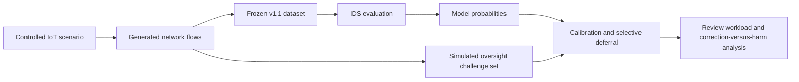

# HITL-IoT: Human-in-the-Loop IoT Dataset

[](https://github.com/wakili-research/HITL-IoT-Dataset/actions/workflows/integrity.yml)
[-1f6feb)](https://journal.benchcouncil.org/TBench)
[](CHANGELOG.md)
[](https://www.kaggle.com/datasets/abubakarwakili/hitl-iot-human-in-the-loop-iot-ids-dataset)
[](https://wakili-research.github.io/HITL-IoT-Dataset/)
[](LICENSE)
[](CITATION.cff)
<!-- After the Zenodo v1.1 record is published, add:
[](https://doi.org/10.5281/zenodo.NNNNNNNN) -->


### Beyond Intrusion Detection: Advancing Trustworthy AI, Human–AI Collaboration, and Oversight in IoT Cybersecurity

**HITL-IoT (Human-in-the-Loop IoT)** is an open, reproducible research dataset and benchmarking framework designed to advance **IoT intrusion detection, trustworthy artificial intelligence, human–AI collaboration, human–AI oversight, and selective deferral**.

Moving beyond conventional intrusion-detection benchmarks that primarily evaluate classification performance, HITL-IoT provides a unified experimental foundation for investigating **not only whether AI can detect cyberattacks, but also how confidently, reliably, and responsibly AI-assisted cybersecurity decisions can be made**.

The benchmark integrates **127,845 IoT network-flow records, 12 attack families, standardized evaluation protocols, nine reference intrusion-detection models, and 10,227 oversight-enriched records with configurable simulated reviewer profiles**.

By combining controlled IoT traffic scenarios, predictive uncertainty, confidence calibration, and structured oversight evaluation, HITL-IoT enables researchers to systematically investigate **when AI security predictions should be accepted, prioritized for review, escalated, or deferred** under reproducible experimental conditions.

Its controlled and transparent research design supports the development and evaluation of **trustworthy, uncertainty-aware, and oversight-informed AI cybersecurity systems**, providing a foundation for advancing human–AI decision-making research in IoT environments.


**Dataset version:** v1.1 · **Core records:** 127,845 network flows · **Oversight challenge set:** 10,227 records · **Primary IDS inputs:** 39 approved features · **Reference models:** 9

### Why researchers use HITL-IoT

- **Detection and decision quality:** compare attack detectors and examine when a prediction should be accepted, reviewed or deferred.
- **Uncertainty and calibration:** measure whether model confidence reflects observed correctness, rather than relying on accuracy alone.
- **Oversight-aware experiments:** evaluate simulated review allocation, selective deferral and correction-versus-harm outcomes at matched review budgets.
- **Comparable, auditable research:** use predefined chronological and IID splits, documented feature permissions, reference predictions and SHA-256 integrity records.

> **Controlled design and research provenance.** HITL-IoT v1.1 uses **deterministically generated IoT network flows with known reference labels** and **configurable simulated oversight profiles**. The 10,227-record oversight challenge set provides structured decisions, confidence, latency and rationales for repeatable comparisons of review and deferral policies. This design supports controlled experiments, traceable evaluation and privacy-conscious research without requiring operational network captures or participant data. The profiles model review behaviour; they are not measurements from recruited cybersecurity analysts.

**Research themes:** IoT cybersecurity · Intrusion detection · Trustworthy AI · Human–AI collaboration · Human–AI oversight · Predictive uncertainty · Confidence calibration · Selective prediction · Learning to defer

**Explore:** [Official research website](https://wakili-research.github.io/HITL-IoT-Dataset/) · [Kaggle dataset](https://www.kaggle.com/datasets/abubakarwakili/hitl-iot-human-in-the-loop-iot-ids-dataset) · [Benchmark code](benchmark/) · [Publication and citation](#citation)

## ⬇ Download the data

**Start with the three core CSVs** in [`data/v1.1/dataset/`](data/v1.1/dataset/). For benchmark-comparable training, also use the [feature policy](data/v1.1/metadata/HITL-IoT_feature_policy_v1.1.json) and [schema](data/v1.1/metadata/HITL-IoT_schema_v1.1.csv) in [`data/v1.1/metadata/`](data/v1.1/metadata/).

| # | File | What it contains | Rows × columns | Size | Download |
|:-:|:--|:--|:-:|:-:|:-:|
| **1** | [`HITL-IoT_dataset_v1.1.csv`](https://github.com/wakili-research/HITL-IoT-Dataset/blob/main/data/v1.1/dataset/HITL-IoT_dataset_v1.1.csv) | **The full dataset:** every flow with features, labels and oversight metadata | 127,845 × 60 | 55.1 MB | [⬇ CSV](https://github.com/wakili-research/HITL-IoT-Dataset/raw/main/data/v1.1/dataset/HITL-IoT_dataset_v1.1.csv) |
| **2** | [`HITL-IoT_splits_v1.1.csv`](https://github.com/wakili-research/HITL-IoT-Dataset/blob/main/data/v1.1/dataset/HITL-IoT_splits_v1.1.csv) | **Official train/validation/test assignment** (`temporal_split` is primary, `iid_split` secondary); join on `flow_id` | 127,845 × 4 | 5.8 MB | [⬇ CSV](https://github.com/wakili-research/HITL-IoT-Dataset/raw/main/data/v1.1/dataset/HITL-IoT_splits_v1.1.csv) |
| **3** | [`HITL-IoT_oversight_subset_v1.1.csv`](https://github.com/wakili-research/HITL-IoT-Dataset/blob/main/data/v1.1/dataset/HITL-IoT_oversight_subset_v1.1.csv) | **The 10,227 oversight-selected flows** (same 60 columns) for deferral and review experiments | 10,227 × 60 | 5.9 MB | [⬇ CSV](https://github.com/wakili-research/HITL-IoT-Dataset/raw/main/data/v1.1/dataset/HITL-IoT_oversight_subset_v1.1.csv) |

Also needed to train models correctly: [`HITL-IoT_feature_policy_v1.1.json`](data/v1.1/metadata/HITL-IoT_feature_policy_v1.1.json) lists the 39 permitted IDS features, and [`HITL-IoT_schema_v1.1.csv`](data/v1.1/metadata/HITL-IoT_schema_v1.1.csv) defines every column.

Load the data directly, without cloning:

```python
import pandas as pd
base = "https://github.com/wakili-research/HITL-IoT-Dataset/raw/main/data/v1.1/dataset/"
df     = pd.read_csv(base + "HITL-IoT_dataset_v1.1.csv", low_memory=False)
splits = pd.read_csv(base + "HITL-IoT_splits_v1.1.csv")
df = df.merge(splits, on=["flow_id", "timestamp"])
train = df[df.temporal_split == "train"]
```

Other access routes: [Kaggle](https://www.kaggle.com/datasets/abubakarwakili/hitl-iot-human-in-the-loop-iot-ids-dataset) · [Research website](https://wakili-research.github.io/HITL-IoT-Dataset/) · `git clone` for data, code and results · [Zenodo status](#data-and-code-access). Verify files using [`HITL-IoT_checksums_v1.1.txt`](data/v1.1/metadata/HITL-IoT_checksums_v1.1.txt).

**Navigate:** [Download](#-download-the-data) · [Overview](#dataset-at-a-glance) · [Design](#benchmark-design) · [Tasks](#research-tasks) · [Results](#reference-results) · [Access](#data-and-code-access) · [Quick start](#quick-start) · [Citation](#citation) · [Research scope](#research-scope-and-interpretation)

---

## Dataset at a glance

| Property | HITL-IoT v1.1 |
|:--|--:|
| Network-flow records | **127,845** |
| Benign / attack records | **108,668 / 19,177** (85% / 15%) |
| Dataset columns | **60** |
| IoT device types / device instances | **5 / 12** |
| Attack families | **12**, across 4 threat groups |
| Simulated oversight subset | **10,227** records |
| Primary IDS feature set | **39** permitted source features |
| Context-enriched IDS feature set | **40** permitted source features |
| Chronological train / validation / test | **89,492 / 19,176 / 19,177** |
| Generation | **Seed 42**, seven-day controlled scenario |

**Device categories:** IP cameras, thermostats, smart speakers, smart TVs and video doorbells.

**Attack coverage:** reconnaissance (port scanning, network mapping, service enumeration); command and control (botnet communication, remote administration, device hijacking); data movement (DNS tunnelling, bulk data transfer, credential harvesting); and device manipulation (protocol abuse, firmware exploitation, configuration tampering).

## Scientific contribution: from detection to decision assurance

HITL-IoT offers a controlled environment in which **classification quality, calibrated confidence and oversight-policy outcomes can be studied together**. Researchers can quantify not only detection errors, but also how review policies allocate limited attention, which errors they identify and when interventions change outcomes.

Four deliberate design choices support rigorous comparisons:

1. **Scenario control:** a documented, seeded smart-home traffic generator with adjustable overlap and ambiguity supports repeatable experiments and known labels.
2. **Leakage-aware feature governance:** labels, construction signals, identifiers and simulated oversight metadata are separated from the primary IDS predictor set.
3. **Model-based uncertainty:** calibration and deferral experiments use probabilities from independently trained IDS models rather than construction-time scores.
4. **Versioned traceability:** fixed evaluation splits, a documented schema, configuration files, benchmark code, reference outputs and SHA-256 manifests make results inspectable and comparable.

## Benchmark design



The **10,227-record oversight challenge set** provides a repeatable test environment for simulated review and deferral policies. It is selected using construction-time ambiguity, and its configurable reviewer profiles are explicit experimental parameters. Their role is to support controlled policy comparisons—not to estimate the behaviour or expertise of recruited professionals. Generated oversight variables are excluded from the primary IDS predictors by the feature policy.

## Research tasks

| Task | Evaluation focus | Suggested measures |
|:--|:--|:--|
| **T1 — Intrusion detection** | Binary benign/attack classification on the frozen split (scorer in [`benchmark/`](benchmark/)) | Macro-F1, balanced accuracy, MCC, AUROC, FPR/FNR |
| **T2 — Probability calibration** | Reliability of model-produced confidence | Brier score, expected calibration error, reliability diagrams |
| **T3 — Selective prediction** | Errors remaining after uncertain cases are deferred | Coverage, selective risk, risk–coverage curves |
| **T4 — Oversight and review allocation** | Which cases are reviewed and whether intervention helps | Review budget, errors reached, corrected vs harmed decisions |
| **T5 — Learning to defer** | Policies allocating cases between model and simulated reviewer | Matched-budget performance, workload and decision cost |
| **T6 — External validation** | Dataset shift with independently collected IoT datasets | Transfer performance, calibration and selective-review behaviour |

T1–T6 summarize the research programme described in the accompanying manuscript. The released benchmark supports controlled evaluation of these tasks; studies with recruited practitioners and deployment settings are complementary opportunities for future validation.

## Reference results

The manuscript evaluates nine model families using a **chronological 70/15/15 train/validation/test protocol**. The validation-selected Random Forest is the reference IDS for subsequent calibration and deferral analyses.

| Model | Chronological test Macro-F1 |
|:--|--:|
| Logistic Regression | 0.9239 |
| SVM (RBF) | 0.9428 |
| **Random Forest** | **0.9688** |
| XGBoost | 0.9677 |
| LightGBM | 0.9682 |
| MLP | 0.9584 |
| 1D-CNN | 0.9624 |
| LSTM | 0.9629 |
| Soft-voting ensemble | 0.9684 |

For the Random Forest reference: **accuracy 0.9849, balanced accuracy 0.9491, MCC 0.9395 and AUROC 0.9690**. Any row can be re-scored from the released held-out probabilities with [`benchmark/score_track1_submission.py`](benchmark/); for example, scoring the Random Forest probabilities gives exactly the values above. Notebook 03 retrains all nine models from scratch.

**External-validation insight:** experiments involving CICIoT2023 and ToN-IoT reveal substantial domain shift and constrained direct transfer. These findings make the benchmark useful for studying recalibration, transfer robustness and the conditions under which oversight policies need adaptation. The reported in-domain scores should be interpreted within the documented experimental protocol.

## Data and code access

| Resource | Purpose | Access |
|:--|:--|:--|
| **Research website** | Visual overview, interactive demonstration, downloads and documentation | [HITL-IoT research portal](https://wakili-research.github.io/HITL-IoT-Dataset/) |
| **GitHub repository** | Source code, documentation, issue tracking and release files | This repository; see [Releases](https://github.com/wakili-research/HITL-IoT-Dataset/releases) |
| **Kaggle** | Dataset discovery, individual data files and example notebooks | [HITL-IoT dataset on Kaggle](https://www.kaggle.com/datasets/abubakarwakili/hitl-iot-human-in-the-loop-iot-ids-dataset) |
| **Zenodo** | Versioned archival deposit and persistent citation | Add the verified **v1.1 version-specific DOI after publication** |

**Version alignment:** The frozen v1.1 data files and verification materials are available in this repository. Kaggle, GitHub Releases and Zenodo maintain separate publication/version histories; check the file names, SHA-256 manifest and version-specific DOI before citing an archived release. Historical v1.0 files remain available for traceability.

### Repository structure

| Path | Contents |
|:--|:--|
| [`data/v1.1/dataset/`](data/v1.1/dataset/) | **The three data files:** full dataset (127,845 × 60), fixed splits, oversight subset (10,227) |
| [`data/v1.1/metadata/`](data/v1.1/metadata/) | Schema, feature policy, configuration, manifest, generation report, v1.0→v1.1 mapping, **generator** (`hitl_iot_generator_v1_1.py`) and SHA-256 checksums |
| [`notebooks/`](notebooks/) | 01 quick start · 02 descriptive analysis · 03 nine-model IDS benchmark · 04 calibration, oversight and selective deferral · 05 external validation |
| [`benchmark/`](benchmark/) | Official Track-1 scorer, protocol, submission template, frozen requirements |
| [`results/`](results/) | Table 7 summary and the result archives (all four: descriptive analysis, nine-model IDS benchmark with held-out probabilities, calibration/oversight/deferral, external validation) |
| [`scripts/`](scripts/) | Download and integrity-verification scripts |
| [`docs/`](docs/) | Project website (GitHub Pages) |
| [`legacy/v1.0/`](legacy/v1.0/) | Preserved v1.0 snapshot for historical comparisons; use v1.1 for new benchmark comparisons |

The repository provides the frozen data files, benchmark code and result archives. The 128.6 MB trained-model package exceeds GitHub's regular file-size limit; use the version-specific Zenodo deposit once its availability is confirmed. Treat externally obtained serialized model files as trusted-code artifacts and load them only in an appropriate isolated environment.

## Quick start

```bash
git clone https://github.com/wakili-research/HITL-IoT-Dataset.git
cd HITL-IoT-Dataset
pip install pandas scikit-learn
python scripts/verify_merged_release.py      # checks all 13 frozen files, counts and splits
```

Then load the data:

```python
import json
from pathlib import Path
import pandas as pd

data_dir = Path("data/v1.1/dataset")     # the three data files
meta_dir = Path("data/v1.1/metadata")    # feature policy, schema, checksums, ...
df = pd.read_csv(data_dir / "HITL-IoT_dataset_v1.1.csv", low_memory=False)
policy = json.loads((meta_dir / "HITL-IoT_feature_policy_v1.1.json").read_text())

primary_features = policy["track1_primary_flow_only"]
assert len(df) == 127_845
assert len(primary_features) == 39
assert all(column in df.columns for column in primary_features)

print("Dataset:", df.shape)
print("Class counts:", df["is_attack"].value_counts().to_dict())
print("Primary IDS features:", len(primary_features))
```

For model training, apply the **provided split assignments**, fit preprocessing only on training records, use the **39 permitted primary features**, and reserve the test partition for final evaluation. Do not add `generated_attack_score`, `generated_prediction`, `ambiguity_score`, simulated oversight fields, labels or identifiers to the primary IDS feature matrix. The schema and policy files are authoritative for individual field roles.

## Citation

**Associated accepted manuscript:**

> Wakili, A., Idris, M., and Bakkali, S. *HITL-IoT: A Reproducible Dataset and Benchmark for Studying Trustworthy Human–AI Collaboration, Oversight Mechanisms, and Selective Deferral in IoT Cybersecurity.*

**Journal:** [*BenchCouncil Transactions on Benchmarks, Standards and Evaluations* (TBench)](https://journal.benchcouncil.org/TBench)  
**Publication status:** Accepted for publication; currently in copyediting. Final article DOI, volume, issue and page details are pending.

For reproducible research, cite **both the associated article and the exact dataset version**. Use [`CITATION.cff`](CITATION.cff) for the current citation metadata; add the verified Zenodo v1.1 DOI after its corresponding deposit is published. The article DOI and the dataset DOI are separate identifiers.

## Research scope and interpretation

HITL-IoT is a **controlled research benchmark**, designed for reproducible comparisons rather than as a replacement for operational telemetry or prospective human-subject studies. The distinctions below help researchers choose valid evaluation questions:

- **Controlled network-flow data:** records and attack labels are generated from a seeded smart-home scenario. The dataset does not contain captured PCAPs or production-network telemetry.
- **Configurable simulated oversight:** reviewer-profile decisions, confidence, latency and rationales are generated experimental signals—not observations from recruited analysts or empirical measures of professional expertise.
- **Chronological evaluation:** the supplied temporal split supports time-ordered testing, but does not alone establish robustness to deliberate concept drift.
- **Cross-domain evidence:** CICIoT2023 and ToN-IoT experiments show meaningful distribution shift, motivating further transfer, adaptation and external validation research.
- **Governance relevance:** the benchmark supports research on risk-aware decision-making and oversight; it is not a certification of regulatory compliance or operational readiness.

These boundaries make the benchmark's intended uses **explicit, auditable and reproducible**, and provide a roadmap for follow-on studies with independent traffic captures and actual cybersecurity practitioners.

## License, contributions and maintenance

The existing dataset release identifies **CC BY 4.0** for data. Source-code licensing and redistribution rights are being reviewed separately; no unverified MIT software license is claimed here. See the applicable license information with each published artifact.

**Corresponding author:** Abubakar Wakili. Reproducibility feedback, metadata corrections and new benchmark ideas are welcome through [GitHub Issues](https://github.com/wakili-research/HITL-IoT-Dataset/issues). Authorship and institutional details will follow the final journal record.

**Version note:** the **dataset is v1.1**; the editorial **manuscript revision v1.2** refers to a separate document version and does not rename the frozen dataset.
